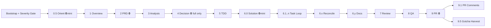
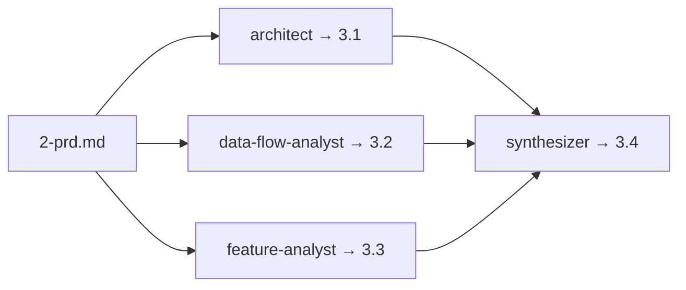
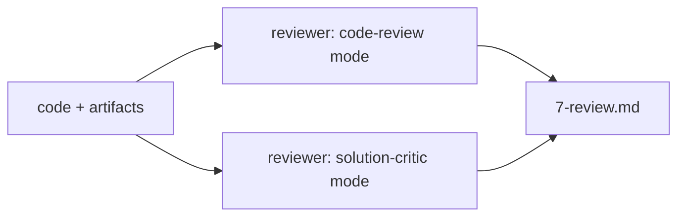

# Flow Manifest: Feature

**Slice**: 1
**Tool-agnostic.** No tool-specific invocation syntax, no `@agent` mentions — a subagent is named by role only (e.g. `architect`). Tool adapters (`src-v2/agents/feature-workflow.agent.md`, slice 5) wire these roles to real spawn calls. See the [manifest lint](../PLAN.md#manifest-lint-portability-claim) this file must pass.

Every phase below is a **delegation contract**: Role, Input, Task, Output. Unless a phase states otherwise, the subagent's return to the orchestrator is exactly: **5-bullet summary + open questions + artifact path + new/updated finding IDs** (see [Architecture § Subagent Delegation Contract](../PLAN.md#subagent-delegation-contract)). The orchestrator compresses that return into a Layer 1 for the dev — see [templates/artifact-template.md](../templates/artifact-template.md) — and never forwards raw subagent output.

Every `Output` file carries the [artifact-status header](../schemas/artifact-status.md) and is tagged `[knowledge]` or `[process]` per [artifact-lifecycle.md](../schemas/artifact-lifecycle.md). Every subagent invocation that uses a skill is prefixed with a [skill-params block](../schemas/skill-params.md).



---

## Phase 0 — Bootstrap & Severity Gate

**Bootstrap** (no subagent — orchestrator, cheap, before anything else): see [bootstrap.md](bootstrap.md) for the `.ai-rules/project.md` presence check, `check` run, and gitignore step. This runs once per flow, not per phase.

**Severity gate** (no subagent — orchestrator, ~30s):

| Step | Action |
|---|---|
| Evidence | Glob/grep the feature's likely touch points from the request's nouns, scoped by `Structure` in `.ai-rules/project.md` (or a blind glob if project.md was declined). Check for schema files, migration folders, API route definitions in that set. `git log --oneline -20 -- <paths>` for churn |
| Propose | State the proposed tier with the evidence, the gates it implies, and what it skips (template below) |
| Confirm | Dev confirms or names a different tier |

```
Proposed tier: MEDIUM
Evidence: ~6 files under src/wallet/, no migration folder touched,
          no new package.json deps implied, existing API route extended.
Gates you'll hit: 2 (PRD), 6.0 (plan), 9 (PR).
Skipping: 3.1/3.2/3.3 parallel split (single analyst), phase 4.

Confirm, or name a different tier.
```

### Tier → phases → gates

| Tier | Criteria | Phases run | Gates |
|---|---|---|---|
| **Small** | ≤2 files est., no new deps, no schema or API contract change, no new component | 1, 2, 5, 6.0–6.x, 6.y, 7, 9 | 2, 9 |
| **Medium** | ≤10 files, no architectural change, single service/app | 0.5, 1, 2, 3.0, 3 (single analyst), 3.4, 5, 6, 6.y, 7, 8, 9 | 0.5, 2, 6.0, 9 |
| **Full** | New subsystem, schema or public API change, cross-service, or dev overrides upward | all | 0.5, 2, 4, 6.0, 9 |

**Phase 0.5 (Orient) is skipped on the `small` tier** — a ≤2-file change doesn't need an onboarding walkthrough. It runs on medium/full, and the dev can also decline it at bootstrap for a specific run regardless of tier (logged in the decision log).

`INDEX.md`'s `tier` field records the choice; `skipped_phases` records what didn't run and why (see [index-frontmatter.md](../schemas/index-frontmatter.md)). Tier may move **up** mid-flow (logged in the decision log at the next gate) but never down after a gate passes.

---

## Phase 0.5 — Orient ⛔ mini-GATE

| Field | Value |
|---|---|
| Role | `task-explainer` (create mode) |
| Skill | `explain-task` |
| Input | the dev's original request, `.ai-rules/project.md` §Structure/§Docs, the severity gate's cheap evidence |
| Task | Write a mobile-first HTML walkthrough's first stage: the problem in plain language, current-state screenshots, solution alternatives with a recommendation, and initial Watch outs. See [skills/explain-task/SKILL.md](../skills/explain-task/SKILL.md) |
| Output | `0.5-walkthrough.html` `[knowledge]` |
| Gate | ⛔ mini — the dev picks or confirms an approach in plain language before phase 1 begins |

**Why before phase 1, not folded into it**: phase 1/2 produce the *formal*, machine-parseable overview and PRD. This phase is a fast, human-readable sanity check — cheaper than a PRD — that catches a wrong approach before any formal spec-writing is invested. It's optional (tier-gated) precisely because that tradeoff isn't worth it on trivial changes.

**This phase also seeds five later deepenings** of the same file — see [task-explainer.agent.md § Mode: update](../agents/task-explainer.agent.md#mode-update-phases-2-60-6x-7-9--five-further-spawns): after the phase 2 gate, after the phase 6.0 gate, after phase 6.x, after phase 7, and after phase 9. Those five are **not gated** — they're informational deepenings of the walkthrough, spawned automatically by whichever phase adapter just completed, not separate entries in this table.

**Rejection**: re-spawn `task-explainer` (create mode) with the dev's objection to the proposed approach; `0.5-walkthrough.html` overwritten wholesale, not appended. See [Failure Edges](#failure-edges).

---

## Phase 1 — Overview

| Field | Value |
|---|---|
| Role | `prd-writer` (overview mode) |
| Skill | `spec-extractor` |
| Input | the dev's original request |
| Task | Capture what the feature is, its business value, and how it fits the product strategy — no requirements detail yet |
| Output | `1-overview.md` `[knowledge]` |

---

## Phase 2 — PRD + Intake Grill ⛔ GATE

| Field | Value |
|---|---|
| Role | `prd-writer` (PRD mode) |
| Skill | `spec-extractor` + `grill-me` |
| Input | `1-overview.md` |
| Task | Produce a clear problem statement, user stories, numbered acceptance criteria (`AC1..ACn`), current vs expected behavior, and the contract surface (API/UI). Grilling happens **during** requirements capture, not as a separate artifact — `grill-me` interviews the dev relentlessly before the PRD is finalized |
| Output | `2-prd.md` `[knowledge]` |
| Gate | ⛔ Dev reviews and approves the PRD before analysis begins |

**Rejection**: re-spawn `prd-writer` with the dev's objection; `2-prd.md` overwritten wholesale. See [Failure Edges](#failure-edges).

**If phase 0.5 ran**: once this gate passes, spawn `task-explainer` (update mode) to deepen `0.5-walkthrough.html`'s Clarify stage — not gated, informational only. See [task-explainer.agent.md](../agents/task-explainer.agent.md#mode-update-phases-2-60-6x-7-9--five-further-spawns).

---

## Phase 3 — Analysis (parallel)



| Sub-phase | Role | Skill | Input | Task | Output |
|---|---|---|---|---|---|
| 3.0 | `component-mapper` skill runs standalone (fast, first) | `component-mapper` | `2-prd.md` + repo | Produce file-level ground truth for the other three analysts | `3.0-component-map.md` `[knowledge]` |
| 3.1 | `architect` | `system-designer` | `2-prd.md`, `3.0-component-map.md` | Architecture with Mermaid diagrams | `3.1-architecture.md` `[knowledge]` |
| 3.2 | `data-flow-analyst` | `component-mapper` | `2-prd.md`, `3.0-component-map.md` | Data flow with Mermaid sequence diagrams | `3.2-data-flow.md` `[knowledge]` |
| 3.3 | `feature-analyst` | — | `2-prd.md`, `3.0-component-map.md` | Senior-SWE-perspective analysis | `3.3-swe-analysis.md` `[knowledge]` |
| 3.4 | `synthesizer` | `tradeoff-analyzer` | `3.1`, `3.2`, `3.3` (full files, not summaries) | Merge into an ADR: decisions, explicitly surfaced conflicts between analysts, any unresolved conflict escalated as a finding to `FINDINGS.md` | `3.4-tradeoffs.md` `[knowledge]` |

**Medium tier** collapses 3.1/3.2/3.3 into a single analyst pass; 3.4 still runs to produce the ADR.

**Why 3.4 is a subagent, not the orchestrator**: merging three conflicting expert analyses is the most judgment-heavy step in the flow. The orchestrator only ever sees Layer 1 summaries of 3.1–3.3, so it structurally cannot do this well.

---

## Phase 4 — Decision Validation ⛔ GATE *(full tier only)*

| Field | Value |
|---|---|
| Role | `quiz-master` |
| Skill | `grill-me` |
| Input | `3.1`, `3.2`, `3.4` (Layer 1 only, per Input Budget) |
| Task | 3 questions that validate *decisions* (why event-driven over polling?), not fact recall |
| Output | `4-quiz.md` `[process]` |
| Gate | ⛔ Dev must **type an answer to at least one** question before the orchestrator proceeds — an unverifiable "answer in your head" is skipped by exactly the dev this gate exists to catch |

**On a wrong or blank answer**: re-present the relevant Layer 1 section, ask once more. Second miss → re-spawn the owning analyst (3.1/3.2/3.4) with "explain decision X more concretely," loop back, log in the decision log. See [Failure Edges](#failure-edges).

---

## Phase 5 — TDD

| Field | Value |
|---|---|
| Role | `tdd-engineer` |
| Skill | `test-generator` |
| Input | `2-prd.md`, the phase-5-relevant analysis sections, **`.ai-rules/project.md` §Test** |
| Task | Behavior contract with numbered, levelled, citable clauses (`C1..Cn` — see [contract-ids.md](../schemas/contract-ids.md)) + failing tests encoding each clause, with pasted red evidence per clause |
| Output | `5-contract.md` `[knowledge]` + failing tests in the repo |

A clause with no red evidence means this phase did not complete — see [contract-ids.md](../schemas/contract-ids.md#red-evidence--mandatory).

---

## Phase 6 — Solution (decomposed)

### 6.0 — Solution Plan ⛔ mini-GATE

| Field | Value |
|---|---|
| Role | `solution-planner` |
| Skill | `tradeoff-analyzer`, `solution-critic` |
| Input | `5-contract.md`, `3.4-tradeoffs.md` |
| Task | Task breakdown (each task = one reviewable diff, ~<150 lines, states why via `AC*`/analysis links, what it touches, dependencies, size S/M/L — **L tasks must split or justify**). Then two adversarial sub-passes against the plan: **stress test** (`solution-critic`) and **pre-mortem** ("it's 3 months from now and this feature caused an incident — what happened?"). Both write to `FINDINGS.md` or a robustness statement — see [findings.md § No quotas](../schemas/findings.md#no-quotas) |
| Output | `6-solution.md` `[knowledge]` |
| Gate | ⛔ mini — dev reviews the task list (reorder/split/merge/reject) before any code is written |

**If phase 0.5 ran**: once this gate passes, spawn `task-explainer` (update mode) to deepen the walkthrough's Plan stage — not gated.

### 6.1..n — Task Loop

One `implementer` spawn per approved task:

| Field | Value |
|---|---|
| Role | `implementer` |
| Skill | `minimal-impl-generator`, `patch-implementer` |
| Input | `5-contract.md` §(clauses for this task) + `6-solution.md` §T{n} + `FINDINGS.md` (open only). **Not** the full PRD or analysis — if T{n} needs architectural context, 6.0 must have inlined it into §T{n} (see [Quality Rules § Input budget](../PLAN.md#quality-rules)) |
| Task | Implement T{n} only. Do not touch anything outside its scope. Every task touching existing behavior leaves 1 regression test per bug-class, not just the bug instance |
| Output | code changes + append to `6-solution.md` §T{n}: what changed, files touched, decisions taken, anything surprising |
| Return | 5-bullet summary + deviations from plan + contract IDs now covered |
| Gate | Per-task review — orchestrator presents a task packet ([templates/task-packet-template.md](../templates/task-packet-template.md)); dev approves → next task; dev comments → same task re-spawned with feedback, task number unchanged |

### 6.x — Reconciliation

| Field | Value |
|---|---|
| Role | `implementer` (final pass) |
| Input | all `6-solution.md` §T{n}, full test tree |
| Task | Run every test level named in `.ai-rules/project.md` §Test (not just unit). Produce the **mechanical contract diff** — see [contract-ids.md § The contract diff](../schemas/contract-ids.md#the-contract-diff-phase-6x-mechanical). Check the task list is complete. Finalize `6-solution.md` into knowledge-artifact form (plan + as-built record) |
| Output | `6-solution.md` finalized `[knowledge]` |

An uncited `C*` clause opens a new task (`T{n+1}: cover C4`) rather than silently amending the contract.

**If phase 0.5 ran**: once reconciliation completes, spawn `task-explainer` (update mode) to deepen the walkthrough's Build stage from the real diff — not gated.

### 6.y — Documentation

| Field | Value |
|---|---|
| Role | `doc-writer` |
| Skill | `documentation-writer` |
| Input | `2-prd.md`, `3.4-tradeoffs.md`, `5-contract.md`, `6-solution.md`, the diff |
| Task | Write the repo's *real* docs (README sections, `AGENTS.md`, architecture docs, glossary) per `.ai-rules/project.md` §Docs — not a workflow artifact. Runs **before** review so the reviewer can check docs match shipped code |
| Output | edits to real repo docs `[knowledge]` |
| Skip condition | Only when the diff touches no public behavior, no config, and no shared vocabulary — orchestrator states which of the three it checked |

---

## Phase 7 — Review (parallel adversarial pair)



| Field | Value |
|---|---|
| Role | `reviewer`, two modes in parallel |
| Skill | `code-review` (mode 1), `solution-critic` (mode 2) |
| Input | code + diff + `2-prd.md` + `3.4-tradeoffs.md` + `5-contract.md` + `6-solution.md` + `FINDINGS.md` + `.ai-rules/review.md` |
| Task | Mode 1 checks business-logic compliance, project-specific rules (`.ai-rules/review.md`), and general quality. Mode 2 re-attacks findings **open since 6.0** against the real code and updates their status — it never re-reports a finding it re-confirms |
| Output | `7-review.md` `[process]` |

**Layer 1 must include**: rules compliance row (`✅ 12/12 rules checked · ⚠️ 1 deviation`), contract coverage row (verbatim from the 6.x diff), Business Logic Review table (see [Business Logic Awareness](../PLAN.md#business-logic-awareness-in-review)), finding delta (`2 closed · 1 still open · 1 new`).

**On ❌**: 🔴 → new task at 6.1, re-run 6.x + 7 for that task only. 🔵 → finding stays `accepted` with a one-line justification, flow continues.

**If phase 0.5 ran**: once review is finalized, spawn `task-explainer` (update mode) to deepen the walkthrough's Review stage — not gated.

---

## Phase 8 — QA (three sub-phases)

### 8.1 — QA Plan

| Field | Value |
|---|---|
| Role | `qa-planner` |
| Input | `2-prd.md`, `5-contract.md`, `6-solution.md`, `FINDINGS.md` (open + pre-mortem entries) |
| Mindset | "I'm a QA engineer trying to break this feature" |
| Task | Manual scenarios (step-by-step) + automated scenarios (**intent only, no selectors** — see the planner constraint below) tagged `happy-path`/`edge-case`/`error-case`/`adversarial`/`hostile-user`. Every open 🔴 finding must have a scenario that would catch it — this replaces any minimum scenario count |
| Output | `8-qa-plan.md` `[knowledge]` |

> ⚠️ **The planner writes no selectors.** It has read the PRD and contract; it has never seen the rendered DOM. Locators invented here (`page.click('text=Create Wallet')`) will not match the implementation. Scenarios are steps + expected outcomes only — **8.3 writes the locators**, from the real components, using `.ai-rules/project.md` §Browser's selector convention.

For non-user-facing features: manual = API calls / CLI invocations / DB queries; automated = the repo's integration runner; no hostile-user scenarios.

### 8.2 — Manual QA

Dev executes `8-qa-plan.md` §Manual scenarios; results recorded in `8-qa-results.md` `[process]` (pass/fail/surprise per scenario). Failures → [Failure Edges](#failure-edges). Surprises → logged for the 9.5 gotcha harvest.

### 8.3 — Automated QA

| Field | Value |
|---|---|
| Role | `qa-automator` (via Playwright MCP) |
| Skill | `design-implementation-validator` for the UI branch |
| Input | `8-qa-plan.md` §Automated scenarios, the implemented components, `.ai-rules/project.md` §Run/§Browser/§Test |

*Environment contract* — read from project.md, never guessed:

| Needs | Source | If absent |
|---|---|---|
| Dev server command + ready pattern | `Run.dev`, `Run.ready_pattern` | Stop and ask — never fall back to `npm run dev` heuristics |
| Base URL | `Browser.base_url` | Stop and ask |
| Auth state | `Browser.auth` | Scenarios needing auth marked blocked, not silently skipped |
| Selector convention | `Browser.selectors` | Default to role/label locators, never CSS classes |
| Data seed/reset | `Test.seed`, `Test.reset` | Run against whatever state exists, flag results unreliable |
| Spec location | `Test.e2e.location` | Write to a temp dir, flag for placement |

*Process*: read implemented components for locators → write real Playwright specs into `Test.e2e.location`, one per scenario, each citing its `A*` id and any `C*`/`F*` it covers → ensure dev server up, seed/reset per scenario → execute → record `8-qa-automated-results.md` `[process]` → flag failures for dev review (ask before assuming flaky).

**UI branch**: a Figma-designed feature invokes `design-implementation-validator` instead of hand-rolled checks — it owns Figma extraction, breakpoint sweeps, Playwright assertion generation, and reads the same environment contract rather than its own dev-server detection.

**Flake handling**: a dev-called-flaky scenario is annotated in `8-qa-plan.md` with date + symptom, re-run once. Two flake calls on the same scenario → 🔵 finding (persistent flake is a defect, not a free pass).

The specs are code and belong in the repo — phase 9 commits them into `Test.e2e.location`. Playwright code never ships as a fenced block inside a markdown artifact.

---

## Phase 9 — PR Creation ⛔ GATE

| Field | Value |
|---|---|
| Role | `pr-manager` |
| Input | `.ai-rules/project.md` §Git & PR, §Docs; all knowledge-tier artifacts; `8.3` Playwright specs |
| Task | PR description + "verify in 2 minutes" section (must have been actually executed during 8.2). Promote knowledge-tier artifacts to `Docs.features` (stripped of status headers, per [artifact-lifecycle.md](../schemas/artifact-lifecycle.md)). Promote 8.3 specs into `Test.e2e.location` so QA scenarios become permanent regression tests |
| Output | PR + `9-pr-notes.md` `[knowledge]` |
| Blocks on | any 🔴 finding still `open` in `FINDINGS.md` |
| Gate | ⛔ Dev reviews and approves PR before merge |

**If phase 0.5 ran**: once the PR is created, spawn `task-explainer` (update mode) to deepen the walkthrough's Ship stage — not gated. This is the walkthrough's final deepening; it's promoted to `Docs.features` in this same phase's promotion step.

## Phase 9.1 — Address PR Comments

`pr-manager` + `address-pr-comments` flow. Updates `9-pr-notes.md` with resolutions. A comment requiring a code change re-enters at 6.1 as a new task.

## Phase 9.5 — Gotcha Harvest

Orchestrator asks "What surprised us?", reads `FINDINGS.md` for `surprise`-tagged entries. Any surprise → one-line addition to the relevant skill's Gotchas section. Also checks: "Did any review finding violate a pattern not in `.ai-rules/review.md`?" → suggests additions (see [Keeping It Accurate](../PLAN.md#keeping-it-accurate) for the trigger-count pruning half of this mechanism). Decision log finalized in `INDEX.md`. Process-tier artifacts may now be deleted.

---

## Failure Edges

| Event | Re-entry point | Artifacts affected | INDEX update |
|---|---|---|---|
| **Gate 0.5 rejected** (approach wrong) | Re-spawn `task-explainer` (create mode) with the dev's objection | `0.5-walkthrough.html` overwritten | decision log: proposed/decided/why |
| **Gate 2 rejected** (PRD wrong) | Re-spawn `prd-writer` with the dev's objection | `2-prd.md` overwritten | decision log: proposed/decided/why |
| **Gate 4 missed twice** | Re-spawn owning analyst (3.1/3.2/3.4) for the unclear decision, then re-quiz | `3.*` overwritten, `4-quiz.md` appended | `current_phase` → 3.x |
| **Gate 6.0 rejected** (task list wrong) | Re-spawn `solution-planner` with the dev's reordering/splitting | `6-solution.md` overwritten | — |
| **Per-task review rejected** | Same task re-spawned with feedback; task number unchanged | `6-solution.md` §T{n} overwritten | — |
| **Contract diff finds a gap** | New task appended (`T{n+1}: cover C4`); contract not silently amended | `6-solution.md`, tests | finding opened |
| **Review 7 finds ❌** | 🔴 → new task at 6.1, re-run 6.x + 7 for that task. 🔵 → `accepted` + one-line justification, continue | `FINDINGS.md` | `open_findings` |
| **QA 8.2/8.3 fails** | Finding opened, new task at 6.1. `5-contract.md` updated first if the failure reveals the contract itself was wrong | `5-contract.md` (maybe), `6-solution.md`, `FINDINGS.md` | — |
| **QA failure suspected flaky** | Orchestrator asks the dev before looping; flaky → scenario annotated, not a finding | `8-qa-plan.md` | — |
| **Gate 9 rejected** | Findings from the dev become tasks at 6.1 | `FINDINGS.md`, `6-solution.md` | — |
| **PR comment requires change (9.1)** | New task at 6.1, then abbreviated 6.x + 7 (changed files only) | `9-pr-notes.md`, `6-solution.md` | — |
| **Any phase artifact is `status: draft`** | Re-spawn that phase wholesale; never patch a partial artifact | that artifact | `current_phase` unchanged |

**Loop-back rule**: re-entering at 6.1 never re-runs phases 1–5 wholesale — only the artifacts named above change. A third loop-back for the same finding escalates: `"F3 has failed three fix attempts — this looks like a design problem, recommend returning to 3.4."`

---

## Related

- [debug-flow.md](debug-flow.md) — same skeleton, debug-specific diffs
- [bootstrap.md](bootstrap.md) — shared flow-start procedure
- [../schemas/](../schemas/) — every convention this manifest assumes
- [../templates/](../templates/) — the fillable shape of every `Output` above
