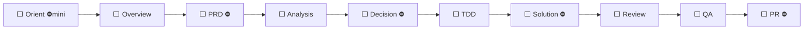

# Template: INDEX.md

**Slice**: 2 · **Schema**: [../schemas/index-frontmatter.md](../schemas/index-frontmatter.md)
**Written by**: the orchestrator, at flow bootstrap and after every phase completion / gate decision — never by a subagent.

````markdown
---
flow: feature
feature: {kebab-feature-slug}
branch: {git-branch}
tier: small | medium | full
started: {YYYY-MM-DD}
current_phase: "{phase}"
last_completed: "{phase}"
gates_passed: []
gates_pending: []
open_findings: []
skipped_phases: []
---

# Feature: {Human Title}

[🟡 IN PROGRESS] · Branch: `{git-branch}` · Tier: {tier}



## Phases

| # | Phase | Artifact | Tier | Status | Gate |
|---|---|---|---|---|---|
| 0.5 | Orient | `0.5-walkthrough.html` | knowledge | ⬜ PENDING | ⛔ mini |
| 1 | Overview | `1-overview.md` | knowledge | ⬜ PENDING | — |
| 2 | PRD | `2-prd.md` | knowledge | ⬜ PENDING | ⛔ |
| ... | | | | | |

Phase 0.5 is omitted from this table entirely on the `small`/`trivial` tier (see [feature-flow.md § Phase 0.5](../flows/feature-flow.md#phase-05--orient)) — don't show a row with no status for a phase that isn't running.

## Open Findings

| ID | Severity | Summary | Status |
|---|---|---|---|

## Decision Log

| Gate | Proposed | Decided | Why |
|---|---|---|---|
````

## Notes

- Node labels in the Mermaid graph carry live status: `⬜` pending → `🔵` in progress → `✅` complete, `⛔` suffix marks a gate node regardless of status.
- The **Phases** table row set differs between feature and debug flows and by tier — start from [../flows/feature-flow.md](../flows/feature-flow.md) or [../flows/debug-flow.md](../flows/debug-flow.md)'s phase list, include only phases the confirmed tier runs (`skipped_phases` in frontmatter covers the rest).
- **Open Findings** mirrors `FINDINGS.md`'s `open` rows exactly — see [findings-template.md](findings-template.md). Don't hand-maintain two different views of finding state.
- **Decision Log** is append-only in practice (rows are never deleted), even though the file as a whole follows the idempotent-overwrite rule for everything except `FINDINGS.md` — see [index-frontmatter.md § Idempotency rule](../schemas/index-frontmatter.md#idempotency-rule). In practice this means: re-write the whole file, but always include every prior decision-log row plus any new one.

## Related

- [../schemas/index-frontmatter.md](../schemas/index-frontmatter.md) — full frontmatter field reference and the resume procedure that reads this file
- [findings-template.md](findings-template.md) — the ledger this file's Open Findings section mirrors
