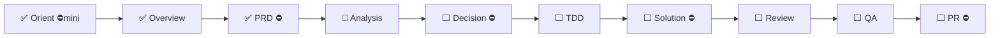

# Subagent-Orchestrated Development Flows

**TL;DR:** Four flows (feature, debug, improvement, greenfield) where a thin workflow agent only orchestrates — stateless subagents do the work, markdown artifacts in `.ai-workflow/[feature]/` are the contract between them. Six adversarial passes (tradeoff digest → plan stress test → pre-mortem → code critique → adversarial QA plan → hostile-user QA) feed one deduplicated finding ledger. Attention-engineered two-layer outputs with comprehension checks; knowledge-tier artifacts are committed and outlive the run, process-tier artifacts are disposable. Tool-agnostic flow manifests + per-tool thin adapters; two repo-owned files (`.ai-rules/project.md` for how the repo works, `.ai-rules/review.md` for what its code must look like) keep the flows portable across repositories. Built in 9 reviewable slices as `src-v2/`, then the earlier v1 workflows were retired into it — see [History](#history-v1-retirement).

---

## Table of Contents

- [Architecture](#architecture)
- [Artifact Lifecycle](#artifact-lifecycle)
- [State & Resumption](#state--resumption)
- [Feature Flow](#feature-flow)
- [Debug Flow](#debug-flow)
- [Improvement & Greenfield Flows](#improvement--greenfield-flows)
- [Failure Edges](#failure-edges)
- [Adversarial Passes & the Finding Ledger](#adversarial-passes--the-finding-ledger)
- [Attention Engineering](#attention-engineering)
- [Visual Document Standards](#visual-document-standards)
- [Quality Rules](#quality-rules)
- [Repository Conventions](#repository-conventions)
- [Repository-Specific Review Rules](#repository-specific-review-rules)
- [Business Logic Awareness in Review](#business-logic-awareness-in-review)
- [Parallel Flows — Git Worktrees](#parallel-flows--git-worktrees)
- [Context Packs](#context-packs)
- [Build Slices](#build-slices)
- [Skill Parameterization](#skill-parameterization)
- [Verification](#verification)
- [Excluded](#excluded)
- [History: v1 Retirement](#history-v1-retirement)

---

## Architecture

### Three-Layer Separation

| Layer | What | Portable? |
|---|---|---|
| Flow manifest (`src/flows/*.md`) | Tool-agnostic phase definitions: roles, inputs, outputs, gates | ✅ plain markdown |
| Skills (`src/skills/`) | Domain knowledge, process, templates, gotchas. Every skill a phase invokes opens with `## Parameters` and `## Where this runs` | ✅ open spec (agentskills.io) |
| Tool adapters (`src/agents/*.agent.md`) | Thin wiring: manifest → subagent spawn calls | ⚠️ per-tool (Copilot-style is the only adapter today) |

**Portability status: designed for, not yet demonstrated.** Only the Copilot-style adapter exists. The claim is verified by a manifest lint (see [Verification](#verification)), not by a second working adapter — don't advertise multi-tool support until one ships.

### Subagent Delegation Contract

Every phase = a delegation contract with 4 parts:

1. **Role** — which agent/skill (e.g. `architect`, `code-review`)
2. **Input** — exact file paths to read (never "read the whole folder")
3. **Task** — one bounded objective
4. **Output** — exact file path + template to write

**Return format** (the only thing the orchestrator sees back): 5-bullet summary + open questions + artifact path + new/updated finding IDs.

### Skill Invocation Convention

Skills are markdown, so "passing parameters" needs a stated convention. The orchestrator prepends a **skill-params block** to the task prompt when spawning a subagent that uses a skill:

```
<!-- skill-params
phase: "3.1"
output: .ai-workflow/multi-wallet/3.1-architecture.md
inputs:
  - .ai-workflow/multi-wallet/2-prd.md
  - .ai-workflow/multi-wallet/3.0-component-map.md
findings: .ai-workflow/multi-wallet/FINDINGS.md
context_pack: src/contexts/duelbits
-->
```

**Rules:**

- A skill's `src/skills/<name>/SKILL.md` references `{{phase}}`, `{{output}}`, `{{inputs}}`, `{{findings}}`, `{{context_pack}}` in its own `## Parameters` section
- Every placeholder has a **documented default** — the phase and output the skill normally runs at
- Unknown keys are ignored; a missing required key means the skill falls back to its default and says so in its return summary
- The block is HTML comment syntax so it renders as nothing in any markdown viewer

This convention is defined in Slice 1 and is a hard prerequisite for [Skill Parameterization](#skill-parameterization).

### Key Principle

**Files are the contract between agents.** Subagents are stateless — they can't see the conversation, only the artifacts you hand them. Every handoff must be: "here are the files to read, here is exactly what to produce, here is the output format."

---

## Artifact Lifecycle

The founding question for this design was *"do we need all the files the AI generates?"* — this section is the answer. Every artifact is tagged `[knowledge]` or `[process]`, and the tag determines where it ends up.

| Tier | Definition | Lives in | On merge | Tracked in git |
|---|---|---|---|---|
| **`[knowledge]`** | Answers a question someone will ask again after this feature ships (why is it built this way, what does it promise, how does data flow) | `.ai-workflow/[feature]/` during the run | Moved to `docs.features` (from project.md) by phase 9 | ✅ committed with the PR |
| **`[process]`** | Records how *this run* went (quiz answers, review findings, QA results). Useful during the run, noise afterwards | `.ai-workflow/[feature]/` | Deleted | ❌ `.ai-workflow/` is gitignored |

### Tier assignment

| Artifact | Tier | Rationale |
|---|---|---|
| `1-overview.md` | knowledge | Business context outlives the run |
| `2-prd.md` | knowledge | Acceptance criteria are referenced in future bug reports |
| `2.1-roadmap.md` (greenfield) | knowledge | The plan for every later milestone — each starts as a feature flow from it |
| `3.0-component-map.md` | knowledge | Reused by the next flow touching this area |
| `3.1-architecture.md` | knowledge | Diagrams answer "why is it shaped like this" |
| `3.2-data-flow.md` | knowledge | Same |
| `3.4-tradeoffs.md` | knowledge | The ADR — the highest-value survivor |
| `4-quiz.md` | process | Comprehension record, no future value |
| `5-contract.md` | knowledge | Source of truth for behavior; referenced by future changes |
| `6-solution.md` | knowledge | Plan + as-built record explains surprising code |
| `6.y-docs.md` | knowledge | Written straight into the repo's real docs, not the workflow folder |
| `7.0-rules.md` | process | Rules compliance for this diff; its catches feed `review.md`'s `triggered:` counts |
| `7-review.md` | process | Findings are either fixed or promoted to the ledger |
| `8-qa-plan.md` | knowledge | Scenarios become the regression suite's starting point |
| `8-qa-results.md` / `8-qa-automated-results.md` | process | Point-in-time run record |
| `9-pr-notes.md` | knowledge | The PR body itself; survives in GitHub |
| `RUNS.md` | process | Which model ran each spawn and how it went; anonymized into the company run log at 9.5, then deleted |
| `FINDINGS.md` | process | Open findings block the PR; resolved ones die with the run |
| `INDEX.md` | process | Flow state, see below |

### Rules

- **Phase 9 performs the promotion**: `pr-manager` copies knowledge-tier artifacts to the path in `.ai-rules/project.md` §Docs `features:` (default `docs/features/[feature]/`), strips Layer 1 status blocks (they're run-scoped), and includes them in the PR diff
- **`.ai-workflow/` is gitignored** — add it to the repo's `.gitignore` at flow start if absent
- **Nothing is deleted before merge.** Process artifacts are removed by the dev after merge, or left to rot harmlessly in an untracked folder
- If a dev wants a process artifact to survive, the fix is to promote the *finding* into a skill's Gotchas section (phase 9.5), not to commit the file

---

## State & Resumption

Subagents are stateless and a full flow will not fit in one context window. The orchestrator must be able to answer "where am I?" from files alone.

### INDEX.md frontmatter (machine-readable)

`INDEX.md` carries YAML frontmatter as the flow's state record. The human-readable body (mermaid, phase table, decision log) sits below it.

```yaml
---
flow: feature
feature: multi-wallet
branch: feat/multi-wallet
tier: full                  # small | medium | full
started: 2026-01-14
current_phase: "3.1"
last_completed: "3.0"
gates_passed: [2]
gates_pending: ["4", "6.0", "9"]
open_findings: [F2, F5]
skipped_phases: []          # with reason, per severity gate
---
```

### Artifact status headers

Every artifact opens with frontmatter so a half-written file is detectable:

```yaml
---
artifact: 3.1-architecture
phase: "3.1"
tier: knowledge
status: draft               # draft | complete
produced_by: architect
updated: 2026-01-14
---
```

A subagent writes `status: draft` first, then flips to `complete` as its final action. **A `draft` artifact means the phase died mid-write and must be re-run from scratch** — never resumed or patched.

### Resume procedure

The orchestrator runs this at the start of every session, before anything else:

1. Read `.ai-workflow/[feature]/INDEX.md` frontmatter → get `current_phase`, `gates_pending`
2. Read the artifact named by `current_phase` → if `status: draft` or missing, re-spawn that phase's subagent with the same contract
3. If `current_phase` is `complete` but its gate is in `gates_pending`, **re-present the gate packet** — never assume a gate was approved off-record
4. Read `FINDINGS.md` → surface any `open` findings in the next Layer 1
5. Announce: `Resuming [feature] at phase N (tier: X) · N gates passed · N open findings`

**Idempotency rule**: re-running any phase overwrites its artifact wholesale. No phase appends to another phase's output. The only append-only file is `FINDINGS.md`.

---

## Feature Flow

### Severity Gate (at start)

Not all features need the full flow. **The orchestrator proposes a tier from evidence, the dev confirms** — asking "what's the scope?" cold puts the judgment on the person least equipped to answer before any analysis has run.

**Before anything else**: check `.ai-rules/project.md` exists and passes `check` — see [Repository Conventions](#repository-conventions). A missing or drifted conventions file is resolved here, not discovered at phase 8.3 when the dev server won't start.

**Evidence the orchestrator gathers first** (cheap, ~30 seconds, no subagent):

- Glob/grep the feature's likely touch points from the request's nouns, scoped by `structure` in project.md
- Check for schema files, migration folders, API route definitions in that set
- Check `git log --oneline -20 -- <paths>` for churn

Then it proposes:

```
Proposed tier: MEDIUM
Evidence: ~6 files under src/wallet/, no migration folder touched,
          no new package.json deps implied, existing API route extended.
Gates you'll hit: 2 (PRD), 6.0 (plan), 9 (PR).
Skipping: 3.1/3.2/3.3 parallel split (single analyst), phase 4.

Confirm, or name a different tier.
```

### Tier → phases → gates

| Tier | Criteria | Phases run | Gates |
|---|---|---|---|
| **Small** | ≤2 files est., no new deps, no schema or API contract change, no new component | 1, 2, 5, 6.0–6.x, 6.y, 7, 9 | 2, 9 |
| **Medium** | ≤10 files, no architectural change, single service/app | 0.5, 1, 2, 3.0, 3 (single analyst), 3.4, 5, 6, 6.y, 7, 8, 9 | 0.5, 2, 6.0, 9 |
| **Full** | New subsystem, schema or public API change, cross-service, or dev overrides upward | all | 0.5, 2, 4, 6.0, 9 |

`INDEX.md` always records the tier, the skipped phases, and why. **Tier can be revised upward mid-flow** — if phase 3 discovers architectural impact, the orchestrator proposes a tier bump at the next gate and logs it in the decision log. Tier is never revised downward after a gate passes.

### Phases

Nine numbered phases plus phase 0.5 (Orient); 21 execution stops once sub-phases are expanded (0.5, 3.0–3.4, 6.0–6.y, 8.1–8.3, 9–9.5). Phase 0.5 is skipped on the `small` tier — see its own subsection below — so a `small`-tier run has 20 stops, not 21.

```
0.5 Orient — living HTML walkthrough, alternatives  ⛔ mini-GATE
1   Overview
2   PRD + intake grill                          ⛔ GATE
3   Analysis (3.0 map → 3.1∥3.2∥3.3 → 3.4 ADR)
4   Decision Validation                         ⛔ GATE (full tier only)
5   TDD: behavior contract + failing tests
6.0 Solution plan + stress test + pre-mortem    ⛔ mini-GATE
6.1..n Task loop (per-task review)
6.x Reconciliation + contract diff
6.y Documentation
7   Review (adversarial pair + business logic + repo rules)
8   QA (8.1 plan → 8.2 manual → 8.3 automated)
9   PR + "verify in 2 min"                      ⛔ GATE
9.1 Address PR comments
9.5 Gotcha harvest
```

#### Phase 0.5 — Orient
- **Subagent**: `task-explainer` (create mode) + `explain-task` skill
- **Output**: `0.5-walkthrough.html` [knowledge]
- **Content**: A mobile-first, living HTML briefing for a new joiner — the problem, current-state screenshots, solution alternatives in plain language, initial Watch outs. See [skills/explain-task/SKILL.md](skills/explain-task/SKILL.md) — adapted from `src-duelbits/skills/explain-task`
- Runs **before** phase 1's formal overview, on the same input (the dev's original request) — a cheap human-readable sanity check on approach before any formal spec-writing is invested
- Skipped on the `small`/`trivial` tier
- ⛔ **mini-GATE**: dev picks or confirms an approach in plain language before phase 1 proceeds
- Deepened five more times, **without a gate**, as the flow progresses: after phase 2's gate (Clarify), after phase 6.0's gate (Plan), after phase 6.x (Build), after phase 7 (Review), after phase 9 (Ship) — see [task-explainer.agent.md](agents/task-explainer.agent.md)

#### Phase 1 — Overview
- **Subagent**: `prd-writer` (overview mode)
- **Output**: `1-overview.md` [knowledge]
- **Content**: What the feature is, business value, how it fits into the overall product strategy

#### Phase 2 — PRD + Intake Grill
- **Subagent**: `prd-writer` (PRD mode) + `grill-me` skill
- **Output**: `2-prd.md` [knowledge]
- **Content**: Clear problem statement, user stories, acceptance criteria (numbered `AC1..ACn`), current vs expected, contract (API/UI)
- **Grilling happens during requirements capture**, not as a separate artifact — the grill-me skill interviews the user relentlessly before finalizing the PRD
- ⛔ **GATE**: Dev reviews and approves the PRD before analysis begins

#### Phase 3 — Analysis (parallel)

```
        ┌─→ @architect          → 3.1-architecture.md
2-prd ──┼─→ @data-flow-analyst  → 3.2-data-flow.md
        └─→ @feature-analyst    → 3.3-swe-analysis.md
                    ↓
            @synthesizer → 3.4-tradeoffs.md (ADR: decisions + conflicts)
```

- **3.0 Component map** — `component-mapper` skill runs first (fast), produces `3.0-component-map.md`. Feeds the other three analysts with accurate file-level ground truth. [knowledge]
- **3.1 Architecture** — `architect` subagent, produces `3.1-architecture.md` with Mermaid diagrams [knowledge]
- **3.2 Data flow** — `data-flow-analyst` subagent, produces `3.2-data-flow.md` with Mermaid sequence diagrams [knowledge]
- **3.3 Senior SWE analysis** — `feature-analyst` subagent, produces `3.3-swe-analysis.md` [knowledge]
- **3.4 Tradeoff digest** — **`synthesizer` subagent** (not the orchestrator) reads 3.1–3.3 in full, applies the `tradeoff-analyzer` skill, and produces `3.4-tradeoffs.md`: an ADR with decisions, explicitly surfaced conflicts between analysts, and any unresolved conflict escalated as a finding. [knowledge]

> **Why a subagent owns 3.4**: merging three conflicting expert analyses is the most judgment-heavy step in the flow. The orchestrator only ever sees Layer 1 summaries of 3.1–3.3, so it structurally cannot do this well — and the architecture says the orchestrator stays thin.

#### Phase 4 — Decision Validation *(full tier only)*
- **Subagent**: `quiz-master`
- **Output**: `4-quiz.md` [process]
- **Purpose**: Validates *decisions* from analysis (why event-driven over polling?), not fact recall. This gate is the last chance to redirect before expensive implementation begins.
- **Mechanism**: 3 questions. The dev must **type an answer to at least one** before the orchestrator proceeds — an unverifiable "answer in your head" is skipped by exactly the dev this gate exists to catch.
- **On a wrong or blank answer**: orchestrator does not fail the dev. It re-presents the relevant Layer 1 section, then asks once more. Second miss → re-spawn the owning analyst (3.1/3.2/3.4) with "explain decision X more concretely" and loop back. Logged in the decision log.
- ⛔ **GATE**: Dev must demonstrate understanding of key decisions before code starts

#### Phase 5 — TDD
- **Subagent**: `tdd-engineer`
- **Reads**: `2-prd.md`, `5`-relevant analysis, **`.ai-rules/project.md` §Test** (framework, level commands, file locations, mocking policy)
- **Output**: `5-contract.md` + failing tests [knowledge]
- **Content**: Behavior contract (inputs → outputs, side effects, error cases) + failing tests that encode the expected behavior

**Contract clauses are numbered, levelled, and citable.** This is what makes the contract diff mechanical rather than inferential:

````markdown
## Contract

| ID | Clause | Kind | Level | Red evidence |
|---|---|---|---|---|
| C1 | `createWallet(userId, "USD")` returns a Wallet with balance 0.00 | happy | unit | `AssertionError: expected undefined to be 0.00` |
| C2 | Duplicate currency for same user → 409, no wallet created | error | integration | `Expected 409, got 500` |
| C3 | Wallet mutation emits `WalletUpdated` within the same transaction | side-effect | integration | `0 events captured, expected 1` |
| C4 | Upstream ledger timeout (>5s) → 503, wallet not persisted | error | integration | `Timeout stub not wired — TypeError` |
| C5 | User sees the new wallet in the list without refreshing | happy | e2e | `locator not found: [data-testid=wallet-row]` |
````

**Level is declared per clause, not left to the implementer.** A clause's kind gives the default; `.ai-rules/project.md` §Test gives the command and file location for each level:

| Clause kind | Default level | Why |
|---|---|---|
| Pure logic, calculation, validation | unit | No I/O to get wrong |
| Error mapping | unit | |
| Side effect (event emitted, row written, cache invalidated) | **integration** | Mocking the effect means testing the mock |
| Cross-boundary contract (status code, response shape, wire format) | integration (API) | |
| User-visible flow | e2e | |

The tdd-engineer may override a default, but must say why in one line. Levels that the repo has no runner for (per project.md) are downgraded with a note, never silently dropped.

**Red evidence is mandatory.** The tdd-engineer runs the suite and pastes the *actual* failure output per clause. A clause with no red evidence means the phase did not complete — the most common LLM-TDD failure is writing a test that already passes, or a tautology, and never noticing because nobody ran it.

**Every test must cite the clause it asserts**, in the test name or a leading comment:

```ts
// C2
it('rejects duplicate currency with 409', async () => { ... });
```

#### Phase 6 — Solution (decomposed)

**6.0 Solution Plan** — `solution-planner` subagent
- **Output**: `6-solution.md` [knowledge]
- **Content**:
  - Task breakdown: each task is one reviewable diff (~<150 lines changed), written as a full spec ([task-spec-template.md](templates/task-spec-template.md)) — exact files, interfaces, inlined context, tests to turn green, done-when — with a model tier: B when no decision is left open, A otherwise ([agent-tiers.md](schemas/agent-tiers.md))
  - **Size budget**: L tasks must split or justify
  - **Stress test**: `solution-critic` skill attacks the plan (see [Adversarial Passes](#adversarial-passes--the-finding-ledger) for the no-quota rule)
  - **Pre-mortem**: "It's 3 months from now and this feature caused an incident. What happened?" — surfaces operational failures (alerting, rollback, data migration risk)
  - Both write findings to `FINDINGS.md` with IDs
- ⛔ **mini-GATE**: Dev reviews the task list — reorder, split, merge, reject — before a single line of code is written

**6.1..n Task Loop** — `implementer` subagent (one spawn per task)
- For each approved task, orchestrator spawns implementer with a **narrow, budgeted** contract:
  - Read: `5-contract.md` §(clauses for this task) + `6-solution.md` §T{n} + `FINDINGS.md` (open only). **Not** the full PRD, not the full analysis — if T{n} needs architectural context, 6.0 must have inlined it into §T{n}
  - Task: implement T{n} only. Do not touch anything outside its scope.
  - Write: code changes + append to `6-solution.md` §T{n}: what changed, files touched, decisions taken, anything surprising
  - Return: 5-bullet summary + deviations from plan + contract IDs now covered
- **Regression gift**: every task touching existing behavior leaves 1 test per bug-class (not just the bug instance)
- **Per-task review**: orchestrator presents a task packet (diff + summary + plan mapping). Dev approves → next task. Dev comments → same task re-spawned with feedback.

**6.x Reconciliation** — `implementer` subagent (final pass)
- Runs every test level named in `.ai-rules/project.md` §Test (not just the unit command)
- **Contract diff** (mechanical): for each `C*` ID in `5-contract.md`, grep the test tree for a citing test and report three things — citation, assertion count, and level match:

```
C1 ✅ wallet.spec.ts:12        · 2 assertions · unit ✅
C2 ✅ wallet.int.spec.ts:40    · 3 assertions · integration ✅
C3 ⚠️ wallet.spec.ts:88        · 1 assertion  · unit ❌ (declared integration)
C4 ❌ no citing test
C5 ⚠️ e2e/wallet.spec.ts:9     · 0 assertions · e2e ❌ empty test body
```

- **Assertion count is what makes the citation meaningful.** A test tagged `// C4` whose body is `expect(true).toBe(true)` passes a naive grep; zero assertions in the citing block counts as uncited. This is the same failure coverage-% targets produce, caught mechanically
- **Level match** compares the citing test's path against project.md's per-level `location` globs. A side-effect clause "covered" by a unit test with a mocked emitter is a finding, not a pass
- Checks task list is complete
- Finalizes `6-solution.md` into knowledge-artifact form (plan + as-built record)

**6.y Documentation** — `doc-writer` subagent
- **Skill**: `documentation-writer`
- **Reads**: `2-prd.md`, `3.4-tradeoffs.md`, `5-contract.md`, `6-solution.md`, the diff
- **Writes**: the repo's *real* docs (README sections, `AGENTS.md`, architecture docs, ubiquitous-language glossary) — not a workflow artifact [knowledge]
- **Runs before review** so the reviewer can check that docs match the code that shipped
- Skipped only when the diff touches no public behavior, no config, and no shared vocabulary — the orchestrator states which of those three it checked

#### Phase 7 — Review (parallel adversarial pair)

```
        ┌─→ @reviewer (code-review mode)     → 7-review.md
code ───┤   reads: code + 2-prd + 3.4-tradeoffs + 5-contract
        │         + 6-solution + FINDINGS.md + .ai-rules/review.md
        │   checks: business logic compliance + project-specific rules + general quality
        │
        └─→ @reviewer (solution-critic mode)   → 7-review.md (stress test section)
            reads: same + FINDINGS.md (open findings from 6.0)
            checks: re-attacks open findings against real code, updates their status
```

- **Output**: `7-review.md` [process]
- **Layer 1 includes**:
  - Rules compliance row: `✅ 12/12 rules checked · ⚠️ 1 deviation`
  - Contract coverage row, taken verbatim from the 6.x mechanical diff
  - Business Logic Review table: acceptance criteria (by `AC*` ID), data flow match, chosen approach, contract coverage, business invariants — each with ✅⚠️❌ status and evidence
  - Finding delta: `2 findings closed · 1 still open · 1 new`
- The critic **updates existing finding IDs** rather than re-reporting them. See [Adversarial Passes](#adversarial-passes--the-finding-ledger).
- See [Repository-Specific Review Rules](#repository-specific-review-rules) and [Business Logic Awareness](#business-logic-awareness-in-review)

#### Phase 8 — QA (three sub-phases)

**8.1 QA Plan** — `qa-planner` subagent (adversarial)
- **Reads**: `2-prd` + `5-contract` + `6-solution` + `FINDINGS.md` (open findings and pre-mortem entries)
- **Mindset**: "I'm a QA engineer trying to break this feature"
- **Output**: `8-qa-plan.md` [knowledge]
- **Content**:
  - Manual test scenarios (step-by-step, for things needing human judgment)
  - Automated test scenarios, written as **intent only**
  - Each scenario tagged: `happy-path` / `edge-case` / `error-case` / `adversarial` / `hostile-user`
  - **Every open finding of severity 🔴 must have a scenario that would catch it.** That requirement replaces the old "≥5 scenarios incl. ≥2 adversarial" quota — coverage is driven by what the flow actually found, not by a number
  - If the flow found nothing adversarial, the plan says so in one line and stays short

> ⚠️ **The planner writes no selectors.** It has read the PRD and the contract; it has never seen the rendered DOM. Locators invented at 8.1 (`page.click('text=Create Wallet')`) will not match the implementation, and the dev spends 8.3 debugging fictional selectors instead of testing the feature. Scenarios are steps + expected outcomes. **8.3 writes the locators**, after reading the real components, using the selector convention in `.ai-rules/project.md` §Browser.

- **Output format example**:

````markdown
# QA Plan: [Feature Name]

## Manual Test Scenarios

### M1: Happy path — user creates wallet ✅ happy-path · covers C1
1. Navigate to /wallets
2. Click "Create Wallet"
3. Select currency "USD"
4. Click "Confirm"
5. **Verify**: New wallet appears in list with balance $0.00

### M2: Double-click submit button ⚠️ hostile-user · covers F3
1. Navigate to /wallets
2. Click "Create Wallet"
3. Fill form
4. **Rapidly double-click** "Confirm"
5. **Verify**: Only one wallet created (no duplicate)

## Automated Test Scenarios (intent — 8.3 writes the code)

### A1: Wallet CRUD happy path ✅ happy-path · covers C1, C2
- **Precondition**: authenticated user, no existing USD wallet
- **Steps**: open wallet list → create wallet (USD) → confirm → reload → delete it
- **Assert**: wallet appears with balance 0.00; survives reload; absent after delete
- **Data**: needs a seeded user with zero wallets

## Coverage Summary

| Category | Manual | Automated | Total |
|---|---|---|---|
| Happy path | 1 | 1 | 2 |
| Edge case | 1 | 0 | 1 |
| Error case | 1 | 1 | 2 |
| Adversarial | 0 | 1 | 1 |
| Hostile user | 2 | 0 | 2 |
| **Total** | **5** | **3** | **8** |

| Open 🔴 finding | Covered by |
|---|---|
| F3 (double-submit race) | M2 |
````

**8.2 Manual QA** — dev executes the manual scenarios
- Dev follows `8-qa-plan.md` §Manual scenarios
- Records results in `8-qa-results.md` (pass/fail/surprise per scenario) [process]
- Any failures → [Failure Edges](#failure-edges)
- Any surprises → logged as findings for gotcha harvest

**8.3 Automated QA** — `qa-automator` subagent via Playwright MCP

*Environment contract* — all of it read from `.ai-rules/project.md` §Run and §Browser, never guessed:

| Needs | Source | If absent |
|---|---|---|
| Dev server command + ready pattern | `run.dev`, `run.ready_pattern` | Stop and ask. Do **not** fall back to `npm run dev` heuristics |
| Base URL | `browser.base_url` | Stop and ask |
| Auth state | `browser.auth` (storageState path, setup spec, or test credentials from env) | Scenarios needing auth are marked blocked, not skipped silently |
| Selector convention | `browser.selectors` | Default to role/label locators, never CSS classes |
| Data seed / reset | `test.seed`, `test.reset` | Run against whatever state exists and flag results as unreliable |
| Spec location | `test.e2e.location` | Write to a temp dir and flag for placement |

*Process*:
1. Read the implemented components for the scenario's surface — **this is where locators come from**
2. Write real Playwright specs into `test.e2e.location`, one per automated scenario, each citing its `A*` id and any `C*`/`F*` it covers
3. Ensure the dev server is up per the environment contract; seed and reset per scenario
4. Execute; record results in `8-qa-automated-results.md` [process]
5. Failures flagged for dev review (could be flakiness — the orchestrator asks before looping back)

*Flake handling*: a scenario the dev calls flaky is annotated in `8-qa-plan.md` with the date and symptom and re-run once. Two flake calls on the same scenario opens a 🔵 finding — persistent flake is a defect in the test or the feature, not a free pass.

**UI branch**: when the feature has a Figma design, this sub-phase invokes the `design-implementation-validator` skill instead of hand-rolled visual checks — it already owns Figma extraction, breakpoint sweeps, and Playwright assertion generation. It reads the same environment contract rather than its own dev-server detection. Non-UI features skip it.

**The specs are code and belong in the repo.** Phase 9 commits them into `test.e2e.location` as part of the PR; `8-qa-plan.md` keeps the intent and links to the spec files. Playwright code never ships as a fenced block inside a markdown artifact.

**For non-user-facing features**: manual scenarios = API calls / CLI invocations / database queries; automated = the repo's integration runner per project.md; no hostile-user scenarios.

#### Phase 9 — PR Creation
- **Subagent**: `pr-manager`
- **Output**: PR + `9-pr-notes.md` [knowledge]
- **Content**: PR description + "verify in 2 minutes" section (must have been actually executed during phase 8.2)
- **Reads**: `.ai-rules/project.md` §Git & PR (branch naming, base branch, PR template path, required checks, merge strategy) and §Docs — no org-detection heuristics
- **Also promotes, into the PR diff**:
  - knowledge-tier artifacts → `docs.features` per [Artifact Lifecycle](#artifact-lifecycle)
  - the 8.3 Playwright specs → `test.e2e.location`, so QA scenarios become permanent regression tests instead of dying with the run
- **Blocks on**: any 🔴 finding still `open` in `FINDINGS.md`
- ⛔ **GATE**: Dev reviews and approves PR before merge

#### Phase 9.1 — Address PR Comments
- **Subagent**: `pr-manager` + `address-pr-comments` flow
- Updates `9-pr-notes.md` with comment resolutions
- A comment requiring a code change re-enters at 6.1 as a new task (see [Failure Edges](#failure-edges))

#### Phase 9.5 — Gotcha Harvest
- Orchestrator asks: "What surprised us?" and reads `FINDINGS.md` for entries tagged `surprise`
- Any surprise → one-line addition to the relevant skill's Gotchas section
- **Also checks**: "Did any review finding violate a pattern not in `.ai-rules/review.md`?" → suggests additions
- Decision log finalized in `INDEX.md` (every gate override: proposed / decided / why)
- Process-tier artifacts may now be deleted

---

## Debug Flow

Same skeleton as feature flow, with these differences:

| Phase | Feature Flow | Debug Flow |
|---|---|---|
| 0.5 | Orient — problem, alternatives | Orient — **the bug**, fix approaches instead of feature alternatives. Skipped on `trivial`, not `small` |
| 2 | Full PRD | Mini-PRD: current vs expected + repro contract |
| 2.5 | — | **Root cause analysis** — `rca-analyst` subagent (`root-cause-analyzer` skill), evidence-based, NO fixes allowed. Output `2.5-root-cause.md` [knowledge] |
| 5 | Behavior contract | Contract's first clause (`C1`) is always the repro: "given repro steps, system does X not Y" |
| 8.1 | QA plan | QA plan must include the repro scenario as its first manual test |
| 8.2 | Manual QA | Manual QA must re-run original repro steps (mandatory) |

### Severity Gate (at start)

Same evidence-then-propose mechanism as the feature flow:

| Tier | Criteria | Phases run | Gates |
|---|---|---|---|
| **Trivial** | Typo, config value, one-line fix, no behavior change beyond the bug | 2 (mini), 5 (repro test), 6.1, 7, 9 | 9 |
| **Standard** | Localized defect with a clear reproduction | 0.5, 1, 2, 2.5, 3.0, 5, 6, 6.y, 7, 8, 9 | 0.5, 2, 6.0, 9 |
| **Deep** | No reliable repro, cross-service, data corruption, or security implication | all + 2.5 extended | 0.5, 2, 2.5, 4, 6.0, 9 |

**Deep tier adds a gate at 2.5**: root cause must be confirmed by the dev before any solution work — the "never jump to fix" rule.

---

## Improvement & Greenfield Flows

Both are diffs against the feature flow, like debug. Full contracts: [flows/improvement-flow.md](flows/improvement-flow.md), [flows/greenfield-flow.md](flows/greenfield-flow.md).

**Improvement** — changes to working code. Core rule: understand before changing.

| Phase | Difference |
|---|---|
| 0 | Same tiers as feature, but 3.0 runs on every tier |
| 1 | Adds a measured **baseline** (metric, today's value, the command that measured it) |
| 2 | `AC*` split into improve and `preserve` criteria |
| 3.0 / 3.4 | Impact analysis (consumers, changed interfaces, blast radius); ADR adds migration + backward compatibility |
| 5 | **Preserve clauses**: characterization tests with green evidence before implementation |
| 7 / 8.2 | Scope-creep check against 3.0's impact list; baseline re-measured, before → after in the PR |

**Greenfield** — new project from scratch. Core rule: vision before code; build Milestone 1 only.

| Phase | Difference |
|---|---|
| 0 | Tiers: prototype / production |
| 2.1 | **Roadmap** (new, ⛔): `roadmap-planner` + `product-manager` → epics, stories, milestones |
| 3.0 / 3.1 | No component map (no code); architect also picks the stack |
| 3.5 | **Scaffold** (new): `implementer` scaffold mode, then `project-mapper map` — project.md doesn't exist before this |
| 6.y / 9 | Docs created from scratch; PR notes add "How to continue" — each later milestone is its own feature flow |

---

## Failure Edges

Every gate and check needs a defined rejection path. Without these the orchestrator improvises, and a stateless orchestrator improvises badly.

| Event | Re-entry point | Artifacts affected | INDEX update |
|---|---|---|---|
| **Gate 2 rejected** (PRD wrong) | Re-spawn `prd-writer` with the dev's objection | `2-prd.md` overwritten | decision log: proposed/decided/why |
| **Gate 4 missed twice** | Re-spawn owning analyst (3.1/3.2/3.4) for the unclear decision, then re-quiz | `3.*` overwritten, `4-quiz.md` appended | `current_phase` → 3.x |
| **Gate 6.0 rejected** (task list wrong) | Re-spawn `solution-planner` with the dev's reordering/splitting | `6-solution.md` overwritten | — |
| **Per-task review rejected** | Same task re-spawned with feedback; task number unchanged | `6-solution.md` §T{n} overwritten | — |
| **Contract diff finds a gap** | New task appended to `6-solution.md` (`T{n+1}: cover C4`); does not silently amend the contract | `6-solution.md`, tests | finding opened |
| **Review 7 finds ❌** | 🔴 → new task at 6.1 and re-run 6.x + 7 for that task only. 🔵 → finding stays `accepted` with a one-line justification, flow continues | `FINDINGS.md` | open_findings |
| **QA 8.2 / 8.3 fails** | Finding opened, then a new task at 6.1. **Phase 5 contract is updated first if the failure reveals the contract was wrong** — a failing scenario that contradicts `5-contract.md` is a contract bug, not a code bug | `5-contract.md` (maybe), `6-solution.md`, `FINDINGS.md` | — |
| **QA failure suspected flaky** | Orchestrator asks the dev before looping; flaky → scenario annotated, not a finding | `8-qa-plan.md` | — |
| **Gate 9 rejected** | Findings from the dev become tasks at 6.1 | `FINDINGS.md`, `6-solution.md` | — |
| **PR comment requires change (9.1)** | New task at 6.1, then abbreviated 6.x + 7 (changed files only) | `9-pr-notes.md`, `6-solution.md` | — |
| **Any phase artifact is `status: draft`** | Re-spawn that phase wholesale; never patch a partial artifact | that artifact | `current_phase` unchanged |

**Loop-back rule**: re-entering at 6.1 never re-runs phases 1–5 wholesale. Only the artifacts named above change. When a loop-back is the third for the same finding, the orchestrator escalates: "F3 has failed three fix attempts — this looks like a design problem, recommend returning to 3.4."

---

## Adversarial Passes & the Finding Ledger

Six passes look for problems: tradeoff digest (3.4), plan stress test (6.0), pre-mortem (6.0), code critique (7), adversarial QA plan (8.1), hostile-user QA (8.2/8.3). Without coordination they re-report the same issue and the dev triages it three times.

### The ledger

One append-only `FINDINGS.md` per flow [process]. Every pass writes here; nothing else does.

```markdown
| ID | Severity | Found at | Summary | Status | Evidence |
|---|---|---|---|---|---|
| F1 | 🔴 | 6.0 stress test | Double-submit creates duplicate wallets | closed @ T3 | wallet.spec.ts:44 |
| F2 | 🔵 | 6.0 pre-mortem | No alert on ledger timeout spike | accepted | out of scope, tracked in OPS-221 |
| F3 | 🔴 | 7 critic | Event emitted outside transaction | open | wallet-service.ts:91 |
```

**Statuses**: `open` · `closed @ T{n}` (fixed, with the task that fixed it) · `accepted` (won't fix, needs a one-line reason) · `superseded by F{n}`.

### Rules

- A later pass that finds an already-logged issue **updates the existing row** — it never creates a new ID. The reviewer's Layer 1 shows a *delta* (`2 closed · 1 still open · 1 new`), not a re-listing
- Only 🔴 findings block phase 9. 🔵 findings need an `accepted` reason to pass
- The orchestrator surfaces open findings in every Layer 1 from the point they're opened

### No quotas

The old rules — `solution-critic` "must find ≥2 failure modes", `qa-planner` "≥5 scenarios incl. ≥2 adversarial" — are removed. Mandatory finding counts manufacture findings on clean work by exactly the logic that makes coverage-% targets produce assertion-free tests, which this plan already rejects.

**Replacement**: each adversarial pass must either log findings **or** write an explicit robustness statement:

```
No failure modes found. Searched: concurrency on the create path, partial
failure between wallet write and event emit, currency validation bypass.
The transaction boundary at wallet-service.ts:88 covers the first two;
the third is enforced by the enum type.
```

That still forces the search — an empty statement is as visible as an empty findings table, and a vague one is a quality signal the orchestrator can challenge.

---

## Attention Engineering

### Core Problem

Plain text docs train devs to skim. AI workflows generate walls of prose that the dev learns to skip, scrolling to the final result. The fix isn't "write better" — it's **structural design that makes skipping harder than reading**.

### Two-Layer Rule

Every artifact and task packet follows a two-layer structure:

- **Layer 1 (always shown, max ~15–20 lines)**: verdict-first, structured, glanceable
  - Status block, never prose
  - Tables not paragraphs
  - Deviation format: "plan said → actually did"
  - Decision-required boxes: `┌ YOUR CALL NEEDED`
- **Layer 2 (collapsible `<details>` sections)**: full detail, read only when Layer 1 flags something

If Layer 1 is boring, that's a quality signal — the work was routine. If it's surprising, the dev reads Layer 2.

> **Layer 1 is the chat surface only. Subagents always read the full file.**
> `<details>` means nothing to a subagent, and Layer 1's length budget exists for the dev's attention, not the model's. The orchestrator compresses **at the chat boundary, never in the file**, and never passes its own Layer 1 summary downstream in place of a path.

### Techniques

| Technique | What | Where |
|---|---|---|
| **Verdict-first headers** | Status block at top, never prose | All outputs |
| **Tables over paragraphs** | Prose banned in Layer 1; allowed only in Layer 2 rationale | All outputs |
| **Diffs against expectation** | "X was expected, Y happened" pattern | Contract diff, task review, QA |
| **Delta blocks** | "Since your last approval: N tasks, M deviations, K findings" | Between gates |
| **Decision-required boxes** | `┌ YOUR CALL NEEDED` — extracted to top, never buried | Gate packets, task reviews |
| **Hard length budgets** | Task packet ≤20 lines L1; tradeoff ≤1 table + 3 bullets/approach; review = findings table only | All templates |

### Visual Grammar (consistent across all artifacts)

| Symbol | Meaning |
|---|---|
| ⛔ | Gate (requires approval) |
| ⚠️ | Deviation / flag |
| ✅ | As-planned / passed |
| ❓ | Open question |
| 🔴 | High severity |
| 🔵 | Low severity |

### Comprehension Checks

Every output includes 2–3 short "why/what-happens-if" questions at the bottom:

```
┌ CHECKS (answer in your head — if you can't, read Layer 2)
│ 1. Why does the retry use exponential backoff instead of fixed delay?
│ 2. What happens to in-flight requests when the timeout fires?
└
```

**Rules**:
- Answerable from Layer 1 + general context — checks understanding, not memorization
- "Why" and "what happens if" questions, never "what"
- Written by the subagent that did the work — it knows which decisions were non-obvious
- 3 questions at gates, 2 elsewhere
- Answers available at bottom of Layer 2

**Where they bind**: at ⛔ gates the dev **types an answer to one** before the orchestrator proceeds (phase 4 defines the miss behavior; other gates just re-show the Layer 2 answer). Everywhere else they are a reading aid with no enforcement — an unenforceable check presented as a control is worse than an honest aid.

**Quality signal — orchestrator-side, not self-assessed.** The old rule ("if the subagent can't write 2 good questions, that's a flag") measures nothing: the subagent grading its own output will always produce two questions. Instead the **orchestrator** rejects and re-requests when a check is:
- answerable by copying a phrase from Layer 1 verbatim
- a "what" question in disguise ("What does the retry use?")
- about a decision the subagent didn't actually make

Three rejections on one artifact → the orchestrator flags the *work* as too mechanical to need a gate, and proposes dropping a tier.

### Orchestrator Compression Duty

**Never present a wall. Never present raw subagent output.** The orchestrator's job at every handoff is compression: subagent produces thorough Layer 2 → orchestrator distills to Layer 1 + decision boxes. Raw artifacts live in files for future reference; the chat surface stays scannable.

---

## Visual Document Standards

Every artifact uses these markdown-native visual patterns (universally renderable, no custom tooling):

| Element | Format | Where used |
|---|---|---|
| Machine state | YAML frontmatter (`status`, `tier`, `phase`) | INDEX.md, every artifact |
| Status tracking | `[🟡 IN PROGRESS]` `[✅ COMPLETE]` `[⛔ GATED]` badges | INDEX.md, every artifact header |
| Progress through flow | Mermaid flowchart with phase statuses in INDEX.md | INDEX.md |
| Decisions needing input | `> ⚠️ **DECISION NEEDED**` blockquote with options | Gate packets, task reviews |
| Layer 2 detail | `<details><summary>📊 Full detail</summary>` collapsible | All artifacts |
| Architecture / data flow | Mermaid diagrams (`graph TD`, `sequenceDiagram`, `stateDiagram-v2`) | 3.1, 3.2, 5-contract |
| Comparisons / tradeoffs | Structured tables with ✅⚠️❌ status column | 3.4, reviews, QA |
| Comprehension checks | `┌ CHECKS` box format | All outputs |
| ADRs | Decision table: Aspect × Option columns, ✅ on chosen | 3.4, 6.0 |
| Acceptance criteria | Table: `AC*` ID \| Status \| Evidence | 7 (review) |
| Contract clauses | Table: `C*` ID \| Clause \| Kind; cited in test names | 5, 6.x, 7 |
| Findings | Table: `F*` ID \| Severity \| Found at \| Status \| Evidence | FINDINGS.md |
| QA scenarios | Numbered scenarios tagged happy-path/edge-case/error-case/adversarial/hostile-user + coverage summary + finding coverage table | 8-qa-plan.md |

**Fence rule for templates**: any template containing a fenced code block must itself be fenced with four backticks. Three-backtick fences nested inside three-backtick fences terminate early and break rendering for everything after.

### INDEX.md example

````markdown
---
flow: feature
feature: multi-wallet
branch: feat/multi-wallet
tier: full
started: <YYYY-MM-DD>
current_phase: "3.1"
last_completed: "3.0"
gates_passed: ["0.5", 2]
gates_pending: ["4", "6.0", "9"]
open_findings: [F2]
skipped_phases: []
---

# Feature: Multi-Wallet Support

[🟡 IN PROGRESS] · Branch: `feat/multi-wallet` · Tier: full



## Phases

| # | Phase | Artifact | Tier | Status | Gate |
|---|---|---|---|---|---|
| 0.5 | Orient | `0.5-walkthrough.html` | knowledge | ✅ COMPLETE | ⛔ PASSED (mini) |
| 1 | Overview | `1-overview.md` | knowledge | ✅ COMPLETE | — |
| 2 | PRD | `2-prd.md` | knowledge | ✅ COMPLETE | ⛔ PASSED |
| 3 | Analysis | `3.*.md` | knowledge | 🔵 IN PROGRESS | — |
| 4 | Decision | `4-quiz.md` | process | ⬜ PENDING | ⛔ |

## Open Findings

| ID | Severity | Summary | Status |
|---|---|---|---|
| F2 | 🔵 | No alert on ledger timeout spike | accepted |

## Decision Log

| Gate | Proposed | Decided | Why |
|---|---|---|---|
| tier | medium | full | schema change found during intake grill |
| 2 (PRD) | Event-driven architecture | Approved as-is | Aligns with existing infra |
````

### NOT used

- ASCII art boxes (break on different screen widths)
- Custom HTML/CSS (not renderable in all markdown viewers)
- Images/screenshots (can't be generated by subagents, can't be diffed)
- PDF/HTML exports (adds tooling complexity, markdown is the universal format)

---

## Quality Rules

| Rule | Description |
|---|---|
| **Regression gift** | Every task touching existing behavior leaves 1 test per bug-class (not just the bug instance) |
| **Size budget** | L tasks must split or justify in plan |
| **Contract diff** | At reconciliation: every `C*` clause must be cited by a test; uncited = finding |
| **Input budget** | A subagent's read list names files *and sections*. The implementer never reads the full PRD or analysis — 6.0 inlines what each task needs into its `§T{n}`. Any artifact over ~200 lines is passed as "Layer 1 + path", and the subagent opens the file only if Layer 1 flags relevance |
| **One ledger** | All adversarial passes write to `FINDINGS.md` with stable IDs; later passes update, never re-report |
| **No quotas** | Adversarial passes log findings or write an explicit robustness statement — never a minimum count |
| **Docs-as-test** | QA executes the PR's "verify in 2 minutes" steps |
| **Decision log** | In INDEX.md: every gate override and tier change → proposed / decided / why |
| **Idempotent phases** | Re-running a phase overwrites its artifact wholesale; only `FINDINGS.md` appends |
| **Skip** | Coverage targets, mutation testing, lint phase — those belong in CI |

---

## Repository Conventions

Flows must run against any repo without the subagents guessing. Today they guess constantly: `test-generator` asks the user which framework every single run, `design-implementation-validator` hardcodes `http://localhost:3000` and throws when it can't infer a dev command, and `create-pr` carries org-detection heuristics. Every one of those is a repo fact that should be stated once and read.

### Two repo-owned files

| File | Nature | Answers | Read by |
|---|---|---|---|
| `.ai-rules/project.md` | **Descriptive** — how this repo works | "How do I run, test, and ship here?" | Phases 0, 5, 6.1..n, 6.y, 8.3, 9 |
| `.ai-rules/review.md` | **Normative** — what code must look like | "Is this code acceptable?" | Phase 7 |

They stay separate. Different lifecycles (review rules grow from gotcha harvest; project facts change when tooling changes) and different failure modes — a stale review rule is a false positive you can argue with, a stale dev-server command is a hard crash mid-flow.

`.ai-rules/project.md` overlaps `AGENTS.md`, which is narrative documentation for humans and general-purpose agents. project.md is the machine-readable subset a phase can act on without interpreting prose. The `project-mapper` skill can seed one from the other; neither replaces the other.

### File structure

Every fact carries the command that proves it. No `last_reviewed` date — same reasoning as [review rules](#keeping-it-accurate): a date measures editing, not accuracy.

````markdown
# Project Conventions — [Project Name]

## Run
package_manager: pnpm              verify: ls pnpm-lock.yaml
install: pnpm install --frozen-lockfile
dev: pnpm dev                      verify: jq -e '.scripts.dev' package.json
dev_url: http://localhost:5173
ready_pattern: /ready in \d+ms/
build: pnpm build
typecheck: pnpm typecheck

## Test
unit:        cmd: pnpm test:unit   location: src/**/*.spec.ts
integration: cmd: pnpm test:int    location: test/integration/**/*.spec.ts
e2e:         cmd: pnpm test:e2e    location: e2e/**/*.spec.ts
single_file: pnpm test:unit -- <path>
mocking: unit mocks all I/O; integration mocks nothing below the HTTP boundary
fixtures: test/factories/          seed: pnpm db:seed:test    reset: pnpm db:reset:test

## Browser
base_url: http://localhost:5173
auth: storageState e2e/.auth/user.json, produced by e2e/auth.setup.ts
selectors: data-testid required — never text content or CSS classes
isolation: one transaction per spec, rolled back in afterEach
viewports: mobile 375, tablet 768, desktop 1280

## Git & PR
branch: <TICKET>-<kebab-summary>   ticket_regex: ^[A-Z]{2,4}-\d+
base: develop                      merge: squash
commit: conventional commits
pr_template: .github/pull_request_template.md
required_checks: [lint, test:unit, test:int]

## Docs
features: docs/features/           adr: docs/adr/
glossary: docs/glossary.md         api: docs/api/

## Structure
aliases: @/ → src/, @components/ → src/components/
new_component: src/components/<Domain>/<Name>/
new_service: src/services/<domain>/
new_route: src/routes/
````

### Two modes

| Mode | What it does | When |
|---|---|---|
| `map` | Inspects the repo — lockfiles, `package.json` scripts, existing test files, CI config, PR template, branch history — and writes `.ai-rules/project.md`. Asks the user **only** where inspection is genuinely ambiguous, and records the answer rather than re-asking next run | First run in a repo; after a tooling change |
| `check` | Executes the `verify:` commands and reports drift as a concrete diff | Flow start; optionally in CI |

**Bootstrapping**: at flow start the orchestrator checks for `.ai-rules/project.md`.

- Missing → offers to run `project-mapper map` (a few minutes) before phase 1, and records the decision in `INDEX.md`
- Present → runs `check`; drift is surfaced in the phase-1 Layer 1, not silently tolerated
- Declined → the flow runs, but every phase that would have read it says which fact it had to guess, and those guesses are listed at the PR gate

### What each phase stops guessing

| Phase | Without project.md | With it |
|---|---|---|
| 0 severity gate | Blind glob from the request's nouns | Globs scoped by the real module layout |
| 5 TDD | Asks the user the test framework **every run** | Framework, per-level command, file location, mocking policy |
| 6.1..n | Implementer invents file paths | `structure.new_*` and path aliases |
| 6.y docs | Guesses where docs live | `docs.features`, `docs.adr`, `docs.glossary` |
| 8.3 browser QA | Hardcoded `localhost:3000`, throws if undetectable | base_url, dev command, auth, seed/reset, selector convention, spec location |
| 9 PR | Org-detection heuristics | Branch pattern, base branch, template, required checks, merge strategy |

### Drift is mechanical, not calendar-based

`check` runs the cheap verifications — does `package.json` still declare `test:e2e`? does the PR template path exist? does `e2e/.auth/user.json` get produced by the named setup spec? A failed verify produces a diff the dev approves, exactly like the [trigger-count pruning](#keeping-it-accurate) mechanism for review rules. Nothing warns on a schedule.

---

## Repository-Specific Review Rules

Projects using these flows define `.ai-rules/review.md` in their repo with project-specific constraints:

### File Structure

````markdown
# Review Rules — [Project Name]

## Required Utilities
- Use `formatCurrency()` from `src/utils/format` for all money display — never manual toFixed
- Use `useAuth()` hook from `src/hooks/auth` — never read token directly from localStorage
- Use `apiClient` from `src/lib/api-client` — never raw fetch/axios for API calls

## Required Components
- Tabular data → `DataTable` from `src/components/ui` — no custom table markup
- Forms → `FormBuilder` from `src/components/forms` — no hand-rolled form state
- Modals → `Dialog` from `src/components/ui` — no custom overlay implementations

## Banned Patterns
- Never use `any` type — use `unknown` + type guard
- Never direct DOM access (`document.getElementById`) — use refs
- Never `console.log` in production code — use `logger` from `src/lib/logger`
- Never import from `../..` — use path aliases (`@/`, `@components/`)

## Architecture Constraints
- Services must not import from controllers (dependency direction: controller → service → repo)
- React components must not call API directly — go through hooks
- Database queries must go through repository layer — no raw SQL outside repos

## Business Invariants
- Wallet amounts must always use `BigDecimal` — never float/number for money
- User permissions checked at service layer, not controller — never trust client
- Game state transitions must follow the state machine in `docs/game-states.md`
- Any mutation on `Wallet` entity must emit `WalletUpdated` event
````

### How It Plugs In

- Phase 7 reviewer input gains one more file: `.ai-rules/review.md`
- Reviewer's Layer 1 output includes a **rules compliance row**: `✅ 12/12 rules checked · ⚠️ 1 deviation (used raw fetch in wallet-service.ts:44)`
- If the file doesn't exist, reviewer notes "no project-specific rules found" and proceeds with general rules only — no hard failure

### Keeping It Accurate

**No `last_reviewed` date field.** A date measures when someone edited the file, not whether the rules are still true, and it's defeated by bumping the date. Two real mechanisms instead:

| Mechanism | Where | What it does |
|---|---|---|
| **Harvest-driven growth** | Phase 9.5 | "Did any review finding violate a pattern not in `.ai-rules/review.md`?" → proposes the addition, with the finding as evidence |
| **Trigger-count pruning** | Phase 9.5 | Each rule carries a `triggered:` count the reviewer increments when the rule actually catches something. A rule at 0 after 10 flows is proposed for deletion — either it's obsolete or it's unenforceable as written |

Both produce a concrete diff for the dev to approve. Neither produces a recurring warning nobody acts on.

---

## Business Logic Awareness in Review

The reviewer reads business artifacts alongside code, not just code in a vacuum:

| Artifact | What reviewer extracts |
|---|---|
| `2-prd.md` | Acceptance criteria (`AC*`) → verify each one has corresponding implementation |
| `3.2-data-flow.md` | Data flow → verify code matches designed flow |
| `3.4-tradeoffs.md` | Chosen approach → verify code follows decided approach, not rejected one |
| `5-contract.md` | Behavior contract (`C*`) → coverage table comes from the mechanical 6.x diff |
| `6-solution.md` | Task plan → verify each task implemented as planned (no drift) |
| `FINDINGS.md` | Open findings → re-attack each against the real code, update status |

### Review Layer 1 — Business Logic Review Section

````markdown
## Business Logic Review

| Criterion | Status | Detail |
|---|---|---|
| Acceptance criteria | ✅ 5/5 implemented | AC1–AC5 all present |
| Data flow match | ⚠️ deviation | 3.2 says wallet→event→notify; code skips event (wallet-service.ts:88) |
| Chosen approach | ✅ | Follows ADR option B (event-driven) |
| Contract coverage | ❌ C4 uncited | Timeout case has no citing test (mechanical diff, 6.x) |
| Business invariants | ⚠️ F3 | Wallet mutation at wallet-service.ts:91 does not emit event (review rule §Business Invariants) |

**Findings delta**: 2 closed · 1 still open (F3) · 0 new

┌ CHECKS
│ 1. Why does the wallet service skip the event emission?
│ 2. What happens if the game state transition is called out of order?
└
````

---

## Parallel Flows — Git Worktrees

Multiple flows can run simultaneously using **git worktrees** — isolated working directories on different branches within the same repo.

```
main repo:  /projects/my-app/             (branch: main)
worktree A: /projects/my-app-feat-auth/   (branch: feat/auth)   → flow A
worktree B: /projects/my-app-feat-wallet/ (branch: feat/wallet) → flow B
```

Each worktree gets its own working directory, `.ai-workflow/[feature]/` folder, branch, and editor window — true parallelism, no file conflicts.

**Commands**: `git worktree add ../my-app-feat-auth feat/auth` to start; `git worktree remove ../my-app-feat-auth` after merge; offer remaining worktrees a rebase on updated main.

### The real constraint

**Parallel flows don't double throughput — the bottleneck is the dev's gate attention, not the machine's.** Two full-tier flows means two PRD gates, two plan gates, two task loops, two PR gates, interleaved. The orchestrator warns before starting a second flow if the first is below phase 6, and suggests staggering so one flow is in its task loop (frequent small approvals) while the other is in analysis (long unattended stretches).

### Overlap detection

Run in two stages, because the accurate data doesn't exist at flow start:

1. **At flow start (cheap, approximate)**: path-glob from the request's nouns, compared against other active flows' `INDEX.md` → "feat/wallet may touch `src/wallet/**`, which flow A is also editing. Proceed or serialize?"
2. **At phase 3.0 (accurate)**: component maps compared directly. If overlap is confirmed and wasn't flagged at stage 1, the orchestrator raises it at the next gate rather than silently continuing.

---

## Context Packs

### Resolution

`src/contexts/<ctx>/` provides template overrides consumed by a skill in `src/skills/<name>/`, passed via the `context_pack` key of the [skill-params block](#skill-invocation-convention).

### Example

```
src/
├── contexts/
│   └── duelbits/
│       ├── pr-template.md        # entry point: title prefixes, body shape
│       ├── pr-workflow.md        # full Duelbits PR process (projects, base branches, Jira)
│       ├── qa-notes.md           # chat-only QA handover notes
│       ├── repository-detection.md
│       └── helpers.js
└── ...
```

The `create-pr` skill is shared (same behavior), but when running in a duelbits context, the orchestrator passes `context_pack: src/contexts/duelbits` and the skill resolves its template from there. No skill fork needed — only the template differs.

### Rules

- Agents and skills are always bundled together — no standalone agents without their referenced skills
- Fork a skill only when the *behavior* differs, not just the template
- Context packs contain templates and configuration, not skill logic

---

## Build Slices

Built in 9 reviewable slices. Each slice is a PR-sized unit presented for approval before moving on.

| Slice | Contents | Dependencies |
|---|---|---|
| **0** | **Foundations**: skill-params convention, artifact lifecycle + tier definitions, INDEX frontmatter schema, artifact status headers, `FINDINGS.md` format, contract-ID + level convention, `.ai-rules/project.md` schema. Nothing downstream is correct without these | None |
| **1** | Flow manifests (`flows/feature-flow.md`, `debug-flow.md`) — tool-agnostic phase definitions, tier→gate tables, failure-edge table | Slice 0 |
| **2** | Artifact templates (`templates/`) — Layer 1/Layer 2 + CHECKS + budgets + visual standards + `review-rules-template.md` + `project-template.md` + QA plan template + `INDEX.md` template + `FINDINGS.md` template. All four-backtick fenced | Slices 0–1 |
| **3** | Subagent roster (16 thin `.agent.md` files, listed below) + the skill parameterization each roster entry's `Skill` column needs (see [Skill Parameterization](#skill-parameterization)) | Slices 0–2 |
| **4** | **Repository conventions**: `project-mapper` skill (`skills/project-mapper/`, new) with `map` + `check` modes, + `repo-mapper` agent + flow-start bootstrap. Lands before the orchestrators so they can read project.md instead of guessing, and its `check` mode is what proves the schema is verifiable | Slices 0–3 |
| **5** | Copilot orchestrators (`orchestrator.agent.md` router + `feature-workflow.agent.md` adapter; resume procedure; severity-gate evidence step; project.md bootstrap; delta blocks; contract-diff; business logic review section) | Slices 1–4 |
| **6** | Debug adapter (`debug-workflow.agent.md` + `rca-analyst` at 2.5 + debug tier table) | Slice 5 |
| **7** | Context packs (`contexts/duelbits/`) + worktree management + overlap detection | Slices 5–6 |
| **8** | Dry run on a **previously shipped** feature (baseline comparison) + negative control + first gotcha harvest | Slices 0–7 |
| **post** | v1 retirement: skills merged in, improvement + greenfield flows ported, `roadmap-planner` added, `src-v2/` renamed to `src/` — see [History](#history-v1-retirement) | Slices 0–7 |

**Slice 4 is the portability slice.** Until it lands, every flow is implicitly hardcoded to whatever repo it was written against. It also retires three existing guess-mechanisms: `test-generator`'s "ASK THE USER" framework step, `design-implementation-validator`'s `detectDevCommand()` heuristics, and `create-pr`'s org-detection references.

### Subagent Roster (Slice 3)

18 agents (16 original + `task-explainer`, added post-slice-8 to wire in `explain-task`, + `roadmap-planner`, added with the greenfield flow). Each file is thin (~30–60 lines): role, input/output contract, skill pointer, fixed return format, comprehension-question generation rule.

| Agent | Role | Skills referenced |
|---|---|---|
| `task-explainer` | Phase 0.5 Orient (create) + 5 later deepenings, no gate on those | `explain-task` |
| `repo-mapper` | Flow start — writes/verifies `.ai-rules/project.md` | `project-mapper` |
| `prd-writer` | Phase 1 (overview) + Phase 2 (PRD + grill) | `spec-extractor`, `grill-me` |
| `roadmap-planner` | Greenfield phase 2.1 — epics, stories, milestones | `product-manager` |
| `architect` | Phase 3.1 architecture analysis | `system-designer` |
| `data-flow-analyst` | Phase 3.2 data flow analysis | `component-mapper` |
| `feature-analyst` | Phase 3.3 senior SWE perspective | — |
| `synthesizer` | Phase 3.4 ADR — merges 3.1–3.3, surfaces conflicts | `tradeoff-analyzer` |
| `rca-analyst` | Debug phase 2.5 root cause (no fixes) | `root-cause-analyzer` |
| `quiz-master` | Phase 4 decision validation | `grill-me` |
| `tdd-engineer` | Phase 5 behavior contract (`C*` IDs) + test intents | `test-generator` |
| `test-writer` | Phase 5 tests from the intents + red evidence | `test-generator` |
| `solution-planner` | Phase 6.0 plan + stress test + pre-mortem | `tradeoff-analyzer`, `solution-critic` |
| `implementer` | Phase 6.1..n task execution (then refactor) + 6.x reconciliation + greenfield 3.5 scaffold | `minimal-impl-generator` or `patch-implementer`, then `refactor-optimizer` |
| `doc-writer` | Phase 6.y documentation (as-built, into the repo's real docs) | `documentation-writer` |
| `rules-checker` | Phase 7.0 written-rule compliance | `code-review` (rules part) |
| `reviewer` | Phase 7 (two modes: code-review + solution-critic) | `code-review`, `solution-critic` |
| `qa-planner` | Phase 8.1 adversarial QA plan | — |
| `qa-automator` | Phase 8.3 Playwright MCP execution; UI branch | `design-implementation-validator` |
| `pr-manager` | Phase 9 PR + 9.1 comments + knowledge-tier promotion | `create-pr` |

---

## Skill Parameterization

The v1 skills hardcoded v1 phase numbers and artifact paths. While v1 was still in use they were left untouched and wrapped by thin v2 overlay files; at v1's retirement each overlay was merged into its skill. Every skill a phase invokes now accepts the [skill-params block](#skill-invocation-convention) directly.

| Skill | v1 hardcoded | Now |
|---|---|---|
| `grill-me` | "Phase 0.1", standalone artifact | Folded inline into `2-prd.md`/`4-quiz.md` |
| `solution-critic` | "Phase 3 (Part B)", "≥2 failure modes" quota | `{{findings}}` ledger; robustness statement instead of a quota |
| `code-review` (was `code-reviewer`) | Feature §8 / Bug §7 / Improvement §7 | `.ai-rules/review.md` + Business Logic Review + `{{findings}}` |
| `root-cause-analyzer` | "Phase 2" | Debug phase 2.5 |
| `spec-extractor` | "Phase 1" | Phases 1–2; numbered `AC*` IDs |
| `component-mapper` | Bug §1 / Improvement §1 | Phases 3.0, 3.2 |
| `tradeoff-analyzer` | Feature §2 / Bug §3 / Improvement §2 | Phases 3.4, 6.0 |
| `test-generator` | Feature §4 / Bug §5 / Improvement §4; asked the user for the framework; unit tests only | Framework/level/location from `.ai-rules/project.md` §Test; every level from the clause kind (absorbed `integration-test-generator`); `C*` citations; red evidence |
| `design-implementation-validator` | `detectDevCommand()` heuristics + hardcoded `localhost:3000` | 8.3 environment contract from project.md §Run/§Browser; detection removed |
| `create-pr` (was `pr-creator`) | Org detection from the git remote | project.md §Git & PR + `{{context_pack}}`; Duelbits specifics moved to `contexts/duelbits/` |
| `documentation-writer` | v1 Phase 3, workflow artifact | Phase 6.y, writes the repo's real docs |
| `system-designer`, `minimal-impl-generator`, `patch-implementer`, `refactor-optimizer`, `product-manager` | v1 phase numbers | Phases 3.1, 6.1..n (+ refactor step), 2.1 (greenfield) |

---

## Verification

### Per-Slice

- Slices 0–2 approved before any agent code
- Slice 4 (`project-mapper`) approved before the orchestrators, so no adapter is written against guessed repo facts
- Each slice = task packet, user approves before next

### Manifest lint (portability claim)

A grep-level check on `src/flows/*.md`: no Copilot-specific syntax, no tool-specific tool names, no `@agent` invocation forms. Fails the slice if the manifest can't be read by a tool that isn't Copilot. This is what backs the tool-agnostic claim until a second adapter exists.

### Dry run (Slice 8) — with a baseline

**Run the flow on a feature that has already shipped** (through v1, or by hand), so there's something to compare against. Assert:

| # | Assertion | Kind |
|---|---|---|
| 1 | All artifacts produced per templates (Layer 1/Layer 2, visual standards, comprehension checks) | presence |
| 2 | Gates presented with decision boxes, not buried in prose | presence |
| 3 | Contract diff mechanically catches at least one uncited `C*` clause | **behavior** |
| 4 | A comprehension check at a gate is answered by the dev without opening Layer 2 | **behavior** |
| 5 | The finding ledger shows at least one finding *updated* by a later pass rather than duplicated | **behavior** |
| 6 | Hostile-user QA surfaces ≥1 non-obvious issue on a user-facing flow | **behavior** |
| 7 | ≥1 gotcha harvested into a skill's Gotchas section post-merge | presence |
| 7a | Every `C*` clause carries real red evidence — pasted failure output, not a claim | **behavior** |
| 7b | The contract diff rejects at least one citing test for zero assertions or wrong level | **behavior** |
| 7c | 8.3 writes Playwright specs from the real DOM into `test.e2e.location`, and they are in the PR diff | **behavior** |
| 7d | `project-mapper check` passes on the target repo, and 8.3 starts the dev server with no hardcoded URL or command | **behavior** |
| 8 | Resume works: kill the session mid-phase, restart, orchestrator resumes at the right phase without re-asking a passed gate | **behavior** |
| 9 | Knowledge-tier artifacts land in project.md's `docs.features` path in the PR diff; process-tier artifacts are absent from git | **behavior** |

**Baseline comparison** (record, don't pass/fail): artifact count, gate count, wall-clock to PR, and the dev's own answer to "did this catch anything v1 missed, and what did it cost?"

### Negative control

Run the flow a second time on a genuinely routine change (a copy tweak, a config value). Assert:

- The severity gate proposes **small** tier from evidence, unprompted
- Total gates ≤2
- Adversarial passes produce robustness statements, not manufactured findings
- Layer 1 outputs are boring

**This is the adoption-critical test.** A flow that's heavyweight on trivial work gets abandoned regardless of how good it is on hard work.

---

## Excluded

| Excluded | Reason |
|---|---|
| `multi-agent-analyzer` (retired v1 skill) | Folded into phase 7 review — its 3 perspectives (quality, edge cases, regression) become reviewer instructions |
| `post-fix-reviewer` (retired v1 skill) | Folded into phase 8 — "re-run original repro + re-attack open findings" |
| `integration-test-generator` (retired v1 skill) | Merged into `test-generator`, phase 5. Each `C*` clause declares its level (kind → default, overridable with a reason), and `.ai-rules/project.md` §Test supplies the runner and location for that level. A separate skill per level re-detects the framework each time |
| `deploy-to-staging`, `debug-issue` (retired v1 skills) | Operational / superseded by the debug flow |
| v1 `backend-engineer` / `frontend-engineer` agents | The `implementer` writes code directly; stack conventions live in `.ai-rules/review.md` and `code-review`'s rule references |
| `design-implementation-validator` | **Not excluded** — it's the UI branch of phase 8.3 |
| `documentation-writer` | **Not excluded** — it's phase 6.y. (v1 had documentation in every workflow; dropping it would have been a silent regression) |
| Coverage % targets | Incentivizes assertion-free tests; contract IDs catch what matters |
| Mutation testing in-flow | Too slow for a per-feature loop; belongs in CI |
| Automated lint/style phase | CI's job, not the workflow's |
| `last_reviewed` staleness dates | Measures editing, not accuracy. Replaced by harvest-driven growth + trigger-count pruning |
| Adversarial finding quotas | Manufactures findings on clean work. Replaced by explicit robustness statements |
| Per-repo forks of test/QA skills | One skill per level per repo doesn't scale. `.ai-rules/project.md` carries the repo delta instead — see [Repository Conventions](#repository-conventions) |
| Replacing `AGENTS.md` | project.md is the machine-readable subset, not a replacement. `agents-md-generator` keeps owning the narrative doc; `project-mapper` can seed from it |

---

## History: v1 Retirement

This design was built as `src-v2/` next to an earlier set of workflows (v1): one large agent file per workflow (feature, bug, improvement, greenfield), numbered `0-startpoint.md`-style artifacts, no `INDEX.md`, no `.ai-rules/project.md`. While both were installed, v2 owned feature/debug and v1 kept improvement/greenfield, and v2 never edited a v1 skill — it wrapped them in overlays instead.

At retirement:

- Every v1 skill v2 used was moved into `src/skills/` with its overlay merged in (see [Skill Parameterization](#skill-parameterization)).
- v1's improvement and greenfield workflows were ported as v2 flows, which brought `product-manager` back (greenfield 2.1) and `refactor-optimizer` back (as the last step of each implementer task).
- Duelbits-specific PR logic moved out of the skill into `contexts/duelbits/`.
- Everything else (v1 agents and prompts, `multi-agent-analyzer`, `post-fix-reviewer`, `debug-issue`, `deploy-to-staging`) was dropped — see [Excluded](#excluded).
- `src-v2/` was renamed to `src/`.

A leftover v1 folder in a target repo (`0-startpoint.md`, no `INDEX.md`) can't be resumed; the orchestrator offers to start a fresh flow from it. Everything v1 is still in git history.
